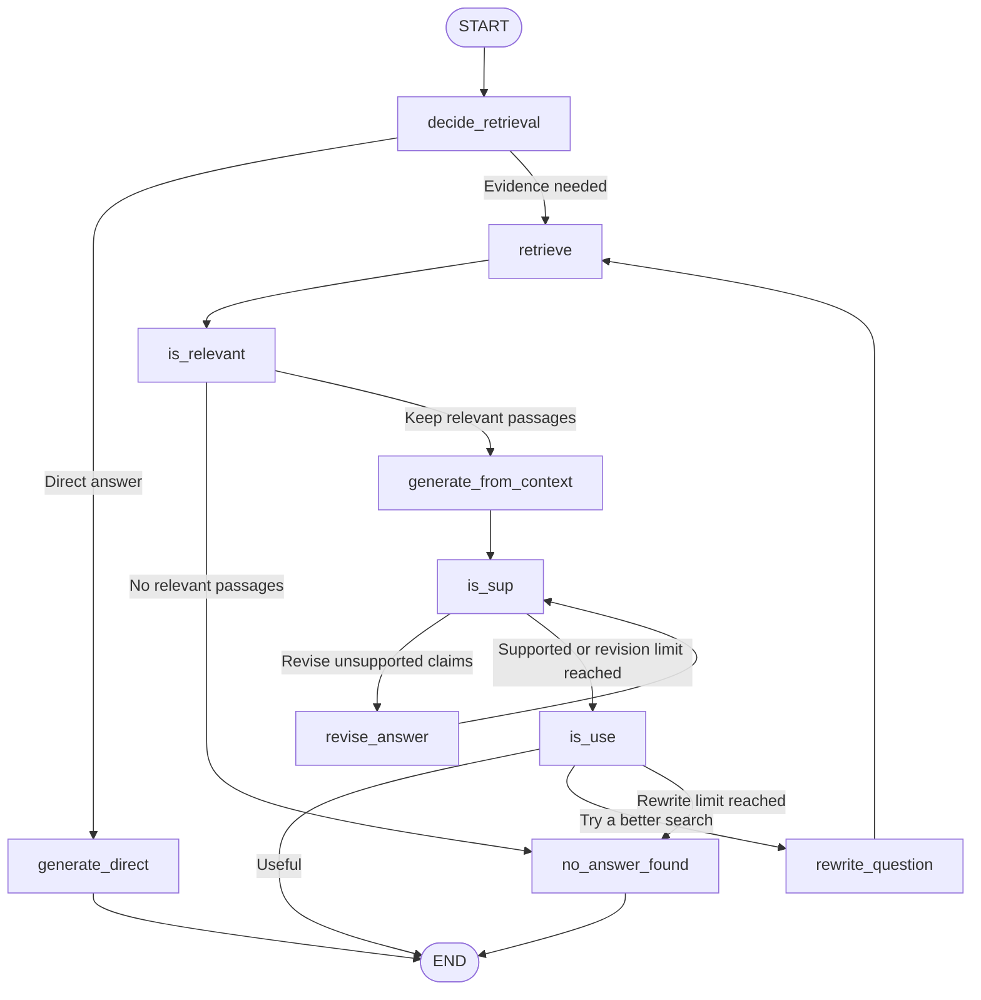

# Self-RAG in LangGraph

## Three problems with traditional RAG

A basic retrieval-augmented generation (RAG) pipeline searches a collection of documents, adds the top passages to the user's question, and asks a language model to answer. That simple sequence leaves three decisions unchecked.

1. **It retrieves even when the user has supplied everything needed.** “Rewrite this sentence politely” can be answered from the sentence itself. Searching a company handbook adds latency and may introduce details the user never asked for.
2. **It trusts whatever the retriever returns.** A search for “Can I get a refund on an annual plan?” might return an annual billing overview. The vocabulary matches, but the passage may say nothing about refunds.
3. **It returns the answer without verifying it.** Even with the right refund policy in the prompt, a model might invent a deadline or omit a condition. A fluent answer can sound more precise than the evidence allows.

**Self-RAG addresses these three problems.**

## What is Self-RAG?

Self-reflective retrieval-augmented generation lets a language model judge when it needs outside information and evaluate how well it uses that information. In the original research, a model learns to emit special **reflection tokens** while generating text. They express decisions such as whether to retrieve, how relevant a passage is, and how well it supports a candidate continuation. Those signals help the system choose among possible continuations as it builds an answer. [Self-RAG paper](https://arxiv.org/abs/2310.11511)

The idea is easier to understand through four questions. Suppose someone asks, **“Can I get a refund on my annual plan, and how do I request it?”**

| Question | What the system judges | What it means in this example |
| --- | --- | --- |
| **Do I need evidence?** | Whether answering reliably requires information outside the prompt. | A provider's refund rules are specific to its policy. Retrieve the policy. |
| **Is this evidence relevant?** | Whether each retrieved passage concerns the user's question. | Keep passages about annual-plan refunds. Discard a passage about changing a billing address. |
| **Does it support my claims?** | Whether the evidence backs the details in the draft. | If the draft promises a refund within seven days, find support for that deadline or revise the claim. |
| **Did I answer the question?** | Whether the answer fulfills the user's request. | An accurate explanation of eligibility still leaves the user asking how to submit the request. |

Relevance compares **question and passage**. Grounding compares **draft and passage**. Usefulness compares **question and draft**. A passage can be relevant while missing a crucial detail, and every sentence in an answer can be supported while the answer still leaves half the question open.

## CRAG and Self-RAG

**CRAG focuses on correcting the evidence before the LLM answers. Self-RAG focuses on deciding when to retrieve and evaluating the answer as it is generated.** Both check whether retrieved passages are relevant to the question. [CRAG paper](https://arxiv.org/pdf/2401.15884) · [Self-RAG paper](https://arxiv.org/abs/2310.11511)

| Feature | CRAG | Self-RAG |
| --- | --- | --- |
| **When to retrieve** | Starts with retrieved documents, then evaluates them. | The model decides whether retrieval would help. |
| **Document relevance** | A retrieval evaluator scores the evidence and uses thresholds to classify the retrieval result as **Correct**, **Incorrect**, or **Ambiguous**. | The model uses a reflection token to judge whether each retrieved passage is relevant. |
| **How it handles weak evidence** | Refines good evidence, replaces poor evidence with web search results, or combines both when uncertain. | Uses relevance and support scores to favor stronger answer candidates. Web search is optional. |
| **How it evaluates the answer** | Its built-in evaluator focuses on the evidence supplied to the generator. | The model checks whether the passage **supports its claims** and whether the overall answer **addresses the user's request**. |

## Self-RAG architecture in this repository

The notebooks translate the four questions into explicit LangGraph nodes. Each grading node asks an LLM for a structured decision. Conditional edges use those decisions to choose the next step. This is a teaching implementation of the research ideas using a prompted model. The two loops below correspond to two different actions a reader can inspect in the code. [Complete workflow notebook](./self_rag_step7.ipynb)

1. **Decide whether to retrieve.** The graph starts at `decide_retrieval`. A general question such as “What is a refund?” can go to `generate_direct` and finish. A question about this company's annual plan goes to `retrieve`. The direct branch ends after generation. The remaining three checks belong to the evidence-based branch in this notebook.
2. **Check each passage for relevance.** The retriever returns candidate documents. The `is_relevant` node reads each one alongside the question and keeps the passages on topic. If none qualify, `no_answer_found` ends the run. Otherwise, `generate_from_context` drafts an answer using the retained evidence.
3. **Check the draft for support.** The `is_sup` node compares claims in the draft with the retained passages and grades the answer as fully supported, partially supported, or unsupported. If the draft invented a seven-day deadline, `revise_answer` can remove it and send the edited draft back for another support check. This loop works with the evidence already in hand. The notebook also advances to `is_use` when the revision counter reaches 10, so arrival there alone does not certify grounding.
4. **Check whether the draft answers the request.** The `is_use` node reads the question and the answer. A useful answer ends the run. If the draft explains eligibility but omits the requested procedure, `rewrite_question` can target the missing detail with a search such as “annual subscription refund request submission process.” The graph returns to `retrieve`, filters the new passages, and generates again. If the answer is still unhelpful after three rewrites, the graph exits through `no_answer_found`.

The distinction between the loops matters in practice. Editing a draft can remove an invented deadline. Finding a missing submission procedure may require a different passage. The separate [web-search notebook](./self_rag_web.ipynb) explores an external search fallback when local retrieval yields no relevant documents.

## Where Self-RAG is useful

- **Customer support.** A support assistant can explain ordinary billing terms directly, then consult policy documents when someone asks about their own plan. Checking usefulness matters when a customer asks both whether they qualify and what to do next.
- **Internal knowledge assistants.** An employee asking about leave eligibility may retrieve passages about several employment categories. Checking support helps catch a draft that silently applies a full-time rule to a contractor.
- **Research and technical documentation.** A passage can describe a benchmark without reporting the result for the model version the reader asked about. Checking a draft against that passage exposes the missing evidence and gives the system a reason to search again or acknowledge the gap.

## Summary

**Self-RAG is a self-reflective system that checks its own work as it builds an answer.** It decides whether it needs to look up information. If it retrieves a passage, it checks whether the passage is relevant and whether it supports the claims the model makes. It also checks whether the overall answer actually addresses what the user asked.

I’d remember it as four questions: **Do I need evidence? Is this evidence relevant? Does it back up what I’m saying? Did I answer the question?**
